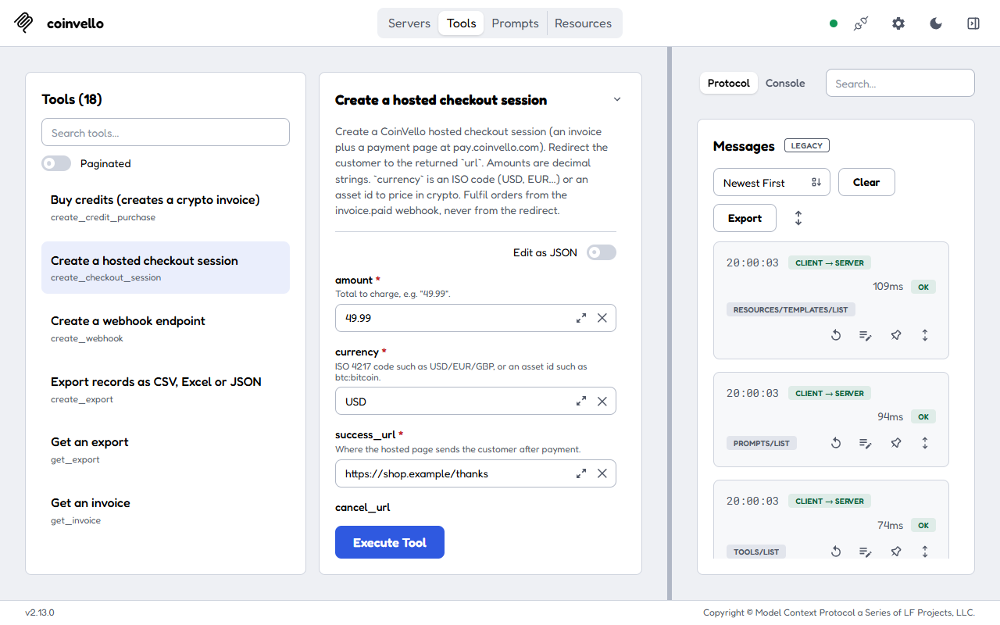
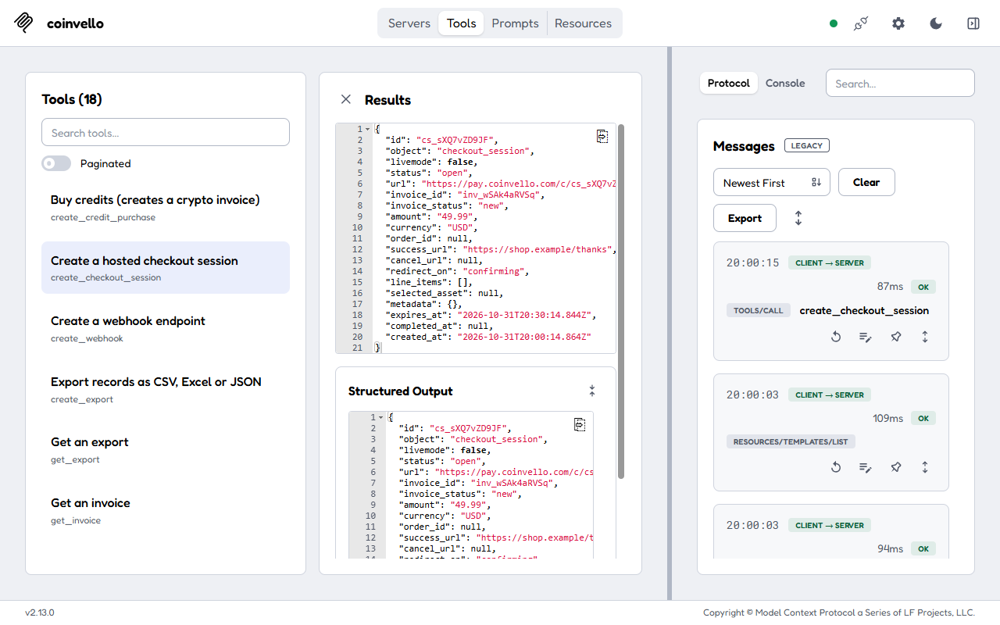
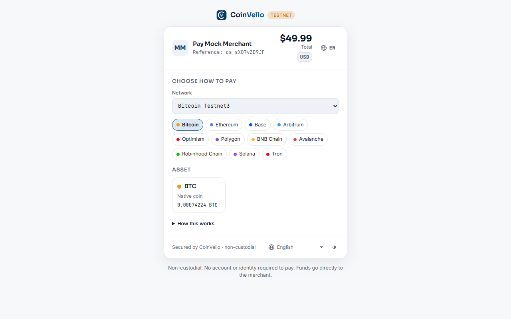

# CoinVello MCP server and AI kit

MCP server and integration kit for [CoinVello](https://coinvello.com), the non-custodial crypto
payment processor: payments go straight to the merchant's own wallet on 11 networks (Bitcoin,
Ethereum, Base, Arbitrum, Optimism, Polygon, BNB Chain, Avalanche, Robinhood Chain, Solana, Tron;
USDC, USDT and more), no KYC, fees are prepaid credits or a fixed on-chain split. Nothing here can
move funds.

## Documentation

- Website and AI setup: https://coinvello.com/ai
- Complete integration guide for LLMs: https://coinvello.com/llms-full.txt
- Developer docs and SDKs: https://coinvello.com/developers
- OpenAPI 3.1 reference: https://coinvello.com/.well-known/openapi.yaml
- npm: https://www.npmjs.com/package/@coinvello/mcp
- MCP Registry: `io.github.CoinVello/coinvello`

## Installation

Get a `cv_test_` API key at https://coinvello.com/app/settings.php (or use any `cv_test_` string
against the local mock server in `api/reference-server`), then add the server to your MCP client.
Claude Desktop, Cursor, Windsurf and VS Code all take this block:

```json
{
  "mcpServers": {
    "coinvello": {
      "command": "npx",
      "args": ["-y", "@coinvello/mcp"],
      "env": { "COINVELLO_API_KEY": "cv_test_..." }
    }
  }
}
```

Claude Code: `claude mcp add coinvello -e COINVELLO_API_KEY=cv_test_... -- npx -y @coinvello/mcp`.
Live keys (`cv_live_`) are refused unless `COINVELLO_ALLOW_LIVE=1`. More clients and the Streamable
HTTP mode: [`api/ai/mcp-server/README.md`](api/ai/mcp-server/README.md).

## Screenshots

The server in the MCP Inspector, creating a checkout session against the local mock API, and the
hosted payment page that session opens:





## Tools

| Tool | Does |
|------|------|
| `create_checkout_session` | `POST /checkout-sessions`: hosted payment page; returns `url` to redirect to and `invoice_id` |
| `get_invoice` | `GET /invoices/{id}` (or `GET /checkout-sessions/{cs_id}?expand=invoice`) |
| `list_invoices` | `GET /invoices` with status / order_id / email filters |
| `list_payments` | `GET /payments` with invoice_id / status / chain / tx_hash filters |
| `create_wallet` | `POST /wallets` (xpub for BTC, address for EVM/Solana/Tron). Refuses xprv locally. |
| `list_wallets` | `GET /wallets` |
| `create_webhook` | `POST /webhooks`; returns the `whsec_` secret once |
| `verify_webhook_signature` | Local HMAC check of a `CoinVello-Signature` header against a raw body (no API call) |
| `get_credits_balance` | `GET /credits/balance` |
| `list_credit_bundles` | `GET /credits/bundles` |
| `create_credit_purchase` | `POST /credits/purchases`; returns payment options + `checkout_url` |
| `get_rates` | `GET /rates` |
| `list_assets` | `GET /assets` (optional chain filter) |
| `simulate_test_payment` | `POST /test/simulate_payment` (test keys only) |
| `list_records` | `GET /records`: the book of record (payments, fees, credit purchases) valued when they happened; filters type / asset / chain / invoice / order / tx / dates / currency |
| `get_records_summary` | `GET /records/summary`: sales, market value received, refunds, fees, net received for a period, optionally grouped |
| `create_export` | `POST /exports`: CSV, Excel or JSON file of records or any dataset (QuickBooks, Xero, Koinly, CoinTracker, CoinLedger presets); returns the export with `download_url` |
| `get_export` | `GET /exports/{id}`: poll status until `ready`, read `file.sha256` and `download_url` |

Every tool returns the raw API JSON (also as `structuredContent`). API errors come back as tool errors
containing `http_status`, the CoinVello `error` envelope (`type`, `code`, `message`, `request_id`) and a `hint`.

## Resources

| URI | Content |
|-----|---------|
| `coinvello://docs/llms-full.txt` | Complete single-file integration guide (auth, checkout, redirect, webhook verification, polling, credits, errors, examples in curl/Node/Python/PHP) |
| `coinvello://docs/llms.txt` | Short llms.txt index |
| `coinvello://openapi.yaml` | OpenAPI 3.1 specification |

Documents are bundled at build time; if missing they are fetched from coinvello.com.

## Prompts

`integrate-coinvello-into-<framework>` for `nextjs`, `express`, `fastapi`, `flask`, `django`,
`laravel`, `rails`, `sinatra`, `go`, `woocommerce`, `shopify`, `generic`, plus
`integrate-coinvello-into-framework` with a free-form `framework` argument. Optional arguments:
`currency`, `assets`. Each prompt tells the agent to read the guide resource, add a checkout route, a
raw-body webhook route with signature verification and `event.id` dedupe, and to verify end to end
with `simulate_test_payment`.

## What else is in this repository

| Path | What |
|------|------|
| [`api/ai/mcp-server`](api/ai/mcp-server) | MCP server, `npx -y @coinvello/mcp` ([npm](https://www.npmjs.com/package/@coinvello/mcp), [MCP Registry](https://registry.modelcontextprotocol.io/v0.1/servers?search=io.github.CoinVello/coinvello): `io.github.CoinVello/coinvello`) |
| [`api/ai/llms-full.txt`](api/ai/llms-full.txt) | The whole integration guide in one file (also at https://coinvello.com/llms-full.txt) |
| [`api/ai/skill`](api/ai/skill) | `coinvello-payments` Agent Skill: drop it into `.claude/skills/` |
| [`api/ai/cookbook`](api/ai/cookbook) | Single-file recipes: Next.js, Express, FastAPI, Flask, Django, Laravel, Sinatra, Go, curl |
| [`api/ai/tool-definitions`](api/ai/tool-definitions) | Tool schemas for Anthropic, OpenAI and Gemini function calling |
| [`api/ai/postman`](api/ai/postman) | Postman collection with a runnable quickstart |
| [`api/reference-server`](api/reference-server) | Mock API: `npm start`, then use `http://localhost:4242/v1` with any `cv_test_` key; signs real webhooks |
| [`api/openapi.yaml`](api/openapi.yaml) | OpenAPI 3.1 reference for `https://api.coinvello.com/v1` |
| [`api/sdks`](api/sdks) | Node, Python and PHP SDKs (`npm install @coinvello/sdk`, `pip install coinvello`) |

SDKs: `npm install @coinvello/sdk`; Python and PHP install commands are on https://coinvello.com/developers.

This repository is a read-only mirror, synced from CoinVello's main repository. Issues are welcome;
security reports go to support@coinvello.com.
